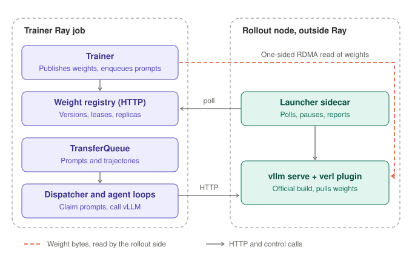

# External vLLM Rollout: Official vLLM Builds as Rollout Replicas

**Authors:** Luosuu

**Last updated:** 2026-11-03

## Background

The `decoupled_async` trainer ([design](decoupled_weight_sync.md)) no longer controls rollout: it
publishes weight versions and enqueues prompts, and each replica decides when to load new weights. The
replicas themselves are still launched by the trainer inside its Ray job, as verl's `vLLMHttpServer`
actors with a verl worker extension, plus one checkpoint engine worker per GPU that hands pulled weights
to vLLM over CUDA IPC.

This design runs rollout as **official vLLM servers** started by a small verl launcher, outside the
trainer's Ray job. verl contributes only a vLLM plugin (a pip-installed weight transfer engine) and a
sidecar process; the vLLM build is unmodified.

## What vLLM already provides

Checked against vLLM 0.32, verl's pinned version:

| Need | vLLM | Note |
| --- | --- | --- |
| Load our pull engine in every worker | Plugins in the `vllm.general_plugins` entry point group; `WeightTransferEngineFactory.register_engine`; engine selected with `--weight-transfer-config` | `VLLM_PLUGINS` selects which plugins load |
| Update weights from outside | HTTP routes `/pause`, `/resume`, `/init_weight_transfer_engine`, `/start_weight_update`, `/update_weights`, `/finish_weight_update`, `/update_weight_version` | Mounted only with `VLLM_SERVER_DEV_MODE=1`, which also enables development endpoints |
| Token-in, token-out generation | `POST /inference/v1/generate`: `token_ids` in; `token_ids`, per-token logprobs, `finish_reason` and `weight_versions` spans out | Needs `--enable-scale-out`; `finish_reason="abort"` marks requests cut by `/pause` |
| Checkpoint-format reload | `initialize_layerwise_reload` / `model.load_weights` / `finalize_layerwise_reload` | The pattern vLLM's own IPC engine uses |

## Architecture



1. **Registry over HTTP.** The trainer serves the existing `InMemoryWeightRegistry` over HTTP. The same
   service is a replica directory: each sidecar reports its server URL and loaded version, with a
   heartbeat. `HttpWeightRegistry` implements `WeightRegistry` for the publisher, the vLLM plugin and
   the sidecar; manifests travel as JSON (bytes base64-encoded, dtypes as names).
2. **vLLM plugin.** `verl_transport_pull`, a `WeightTransferEngine` registered through the
   `vllm.general_plugins` entry point. `init_transfer_engine` creates a `WeightPuller` against the
   registry URL; `start_weight_update` starts a layerwise reload; `receive_weights({"version": v})`
   pulls version `v` into the worker's host mirror under a lease and loads it with
   `model.load_weights`; `finish_weight_update` finalizes the reload. The checkpoint engine worker and
   the CUDA IPC hop disappear.
3. **Launcher.** `python -m verl.workers.rollout.vllm_rollout.external_launcher` sets `VLLM_PLUGINS`
   and `VLLM_SERVER_DEV_MODE`, starts `vllm serve` with `--weight-transfer-config
   '{"backend": "verl_transport_pull"}'`, `--enable-scale-out` and the user's vLLM arguments, waits for
   it to be healthy, and runs the sidecar.
4. **Sidecar update agent.** The same policy as `WeightUpdateAgent`, driving vLLM's HTTP routes instead
   of Ray actors: when a newer version is ready, `/pause` (abort) → `/start_weight_update` →
   `/update_weights` → `/finish_weight_update` → `/update_weight_version` → `/resume`, then report the
   new version to the registry.
5. **Generation client.** An `HttpServerHandle(url)` stands in for a vLLM server actor handle: its
   `generate.remote(...)` calls `/inference/v1/generate` and returns verl's `TokenOutput`
   (`finish_reason="abort"` → `stop_reason="aborted"`, so `FullyAsyncLLMServerClient` resubmits it; the
   last weight version span → `global_steps`). The load balancer and client are unchanged.
6. **Trainer wiring.** `trainer.v1.decoupled_async.external_rollout.enable` makes the trainer start the
   registry server instead of launching replicas, wait for `min_replicas` sidecars to register, and build
   the LLM client from their URLs. The prompt dispatcher reads replica versions from the registry.

Agent loops and the dispatcher stay in the trainer's Ray job for now: they are CPU actors, and keeping
them there means TransferQueue does not need to be reachable from outside.

## Usage

Start the rollout servers, on nodes with vLLM, verl and nixl installed (an official vLLM wheel; verl
provides only the plugin). They wait for the trainer's registry, so they can start first:

```bash
python -m verl.workers.rollout.vllm_rollout.external_launcher \
    --registry-url http://<trainer node>:8900 --port 8000 -- \
    ~/models/Qwen/Qwen2.5-0.5B-Instruct --tensor-parallel-size 2 --gpu-memory-utilization 0.6
```

Then the trainer, on nodes that do not include the rollout GPUs:

```bash
bash tests/special_e2e/run_v1_separate_async.sh \
    trainer.v1.trainer_mode=decoupled_async \
    actor_rollout_ref.rollout.checkpoint_engine.backend=transport_pull \
    trainer.v1.decoupled_async.external_rollout.enable=True \
    trainer.v1.decoupled_async.external_rollout.registry_port=8900 \
    trainer.v1.decoupled_async.external_rollout.min_replicas=2
```

| Option | Default | Meaning |
| --- | --- | --- |
| `trainer.v1.decoupled_async.external_rollout.enable` | `false` | Generate on external servers instead of launching replicas. |
| `...external_rollout.registry_port` | `0` | Port of the weight registry server; `0` picks one and logs the URL. |
| `...external_rollout.min_replicas` | `1` | Servers to wait for before training starts. |
| `...external_rollout.wait_timeout` | `1800` | Seconds to wait for them. |
| `...external_rollout.heartbeat_timeout` | `60` | A server that has not reported for this long fails the job. |

## Results

GSM8K async GRPO, Qwen2.5-0.5B-Instruct, 30 steps, one seed, one node: the trainer on 4 GPUs and two
official `vllm serve` servers (TP=2) started by the launcher on the other 4, outside the trainer's Ray
job. The other columns run the same setup with replicas launched by the trainer.

| Metric | `separate_async` + `nccl` | `decoupled_async`, in-job replicas | `decoupled_async`, external vLLM |
| --- | --- | --- | --- |
| Validation accuracy at steps 10 / 20 / 30 | 0.079 / 0.438 / 0.477 | 0.327 / 0.456 / 0.501 | 0.125 / 0.421 / 0.470 |
| Training score, steps 26–30 | 0.428 | 0.483 | 0.461 |
| Step time (mean, steps 2–30) | 5.80 s | 4.74 s | 4.71 s |
| Trainer time in `update_weights` | 1.26 s | 0.14 s | 0.15 s |
| Weight versions per trajectory / staleness | 1.0 / 1.0 | 1.0 / 1.0 | 1.0 / 1.0 |

Both servers loaded every published version (pull ~0.4 s, load ~0.07 s per update at 0.5B), and
learning matches the in-job modes within single-seed noise.

## Limitations

- **Development endpoints.** `VLLM_SERVER_DEV_MODE=1` exposes unauthenticated control routes; the
  rollout servers must sit on a network only the trainer can reach.
- **No prefetch.** The plugin pulls inside `/update_weights`, so generation is paused for the whole
  transfer. Prefetching needs either a background pull in the plugin or a vLLM route that runs the
  engine outside the pause.
- **Fixed replica set.** The trainer uses the replicas registered at startup; replicas joining or
  leaving during training are follow-ups.
- **Text-only.** The HTTP client sends token IDs and sampling parameters; multimodal inputs and
  routed-expert capture are not forwarded.
- **vLLM API drift.** The plugin targets vLLM 0.32's `WeightTransferEngine` interface.
- **No pause metrics.** The sidecar does not report how long each update paused the server, so the
  trainer logs only the replicas' versions.
- **Fail-closed sidecar.** A failed update stops the launcher and its server; the trainer then fails
  on the missing heartbeat. Restarting a server and rejoining is not supported yet.
